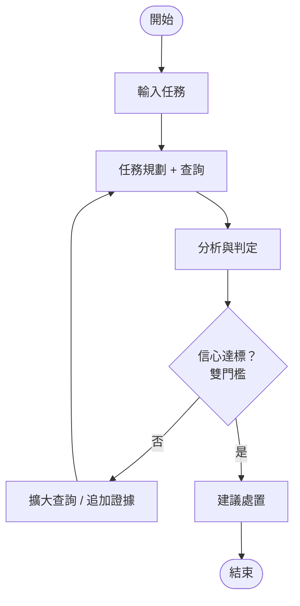

# AI SOC Analyst Agent 資安專題總覽

**AI SOC Analyst Agent — A Domain AI Agent for Next-Gen SOC**

*Smarter Triage. Safer Enterprise.*


> 以下為上方總覽圖的文字版內容。

## ✅ 符合度總覽：期末專題提案作業規範核心維度（1.1 – 1.4）

| 維度 | 重點 | 說明 |
|---|---|---|
| **1.1 AI Agent** | ReAct 推理 + 任務規劃<br>自動化告警調查與分級<br>人機協作、可解釋決策 | Domain AI Agent，非單純 Chatbot |
| **1.2 領域知識** | ATT&CK 戰術知識<br>NIST SP 800-61<br>資安專業知識庫 | 結合資安領域知識 |
| **1.3 數據分析** | ML 分級（GBDT）<br>SHAP 可解釋性<br>多元評估指標 | 深度數據分析與洞察 |
| **1.4 真實應用** | 實戰 SOC 場景<br>降低漏判與誤報<br>可部署與擴展 | 提升資安維運效率 |

## 1. Abstract 摘要（A–F 六段式故事軸）

| 段落 | 內容 |
|---|---|
| **A. Attention Getter** | 2025 國安局：263 萬次/日；IBM 2026：$4.99M、247 天 |
| **B. But** | 誤報多、漏判高（40.4%+） |
| **C. Cure** | AI SOC Analyst Agent |
| **D. Development** | ReAct + GBDT + MITRE |
| **E. Experiments** | GUIDE & ExCyTIn-Bench 評估 |
| **F. Findings** | 降低漏判率、量化取捨 |

## 2. Introduction 緒論

1. **背景**：國安局 + Mandiant 數據，攻擊者潛伏時間：14 天
2. **問題**：能否設計可信、可解釋的 AI Agent？
3. **限制**：ML 無攻擊鏈、LLM 易漏判
4. **創新**：7 面向對照表
5. **貢獻**：系統／方法／實驗等 5 項

## 3. Related Work 相關研究

1. 16 篇文獻（1/2 AI + 1/2 Domain）
2. **AI Technology（8）**：ML、LLM、RAG、Benchmark
3. **Domain Know-how（8）**：告警疲勞、Kill Chain、NIST
4. **Research Gap**：新的 AI SOC 解法

## 4. Deep Research 三大核心問題

**Q1. 五大思維模式**

1. Assume Breach
2. 事件與攻擊鏈
3. 錯誤成本不對稱
4. 看 TTPs 而非 IOCs
5. 自動化要可驗證

**Q2. 三大專業爭論**

1. 全自動 vs 人機協作
2. 規則式 vs 機器學習
3. 公開資料代表性

**Q3. 十大深度理解問題**

- Why / What-if / Trade-off
- Failure Case / Evidence
- Comparison / Design
- Real-world Scenario

## 5. Proposed Scheme 系統設計

### 5.1 8 大模組架構

1. User/Scenario
2. Query/Input
3. Planner & Reasoning Agent
4. Data Acquisition/Retrieval
5. Analytics Engine
6. Domain Knowledge
7. Decision/Recommendation
8. Output & Interaction

### 5.2 Flowchart 流程



### 5.3 Pseudocode 主演算法

```text
Algorithm 1: SOC Triage Agent
1   Input: alert, context
2   while not confident do
3       plan   ← React(alert)
4       data   ← retrive(plan)
5       result ← analyze(data)
6       if high-confidence(result) then
7           return recommendation
8       else
9           refine_query()
10  end while

Algorithm 2: FuseEvidence
1   Input: evidence, set
2   return SHAP + rule fusion
```

## 6. 研究方法與技術

**ReAct LLM 推理** + **GBDT 機率預測** + **MITRE ATT&CK 知識** + **Chroma 檢索** + **誤報融合安全升級**

## 7. 實驗規劃與評估

- **資料集**：Microsoft GUIDE（100 萬事件）、ExCyTIn-Bench
- **評估指標**：Macro-F1、TP 漏判率、人工升級率

## 8. 主要創新亮點

- ✅ 結合 ML + LLM + 領域知識
- ✅ 可解釋與證據鏈
- ✅ 人機協作與主動升級
- ✅ 量化漏判 vs 升級取捨

## 9. 預期成果

- ⭐ 降低 TP 漏判率
- ⭐ 提供高可解釋報告
- ⭐ 具備實際部署價值

## 10. 完整實作規劃

- ✅ 建置 GitHub Repo & DESIGN.md
- ✅ 提供 Final PPT 與 Demo 影片
- ✅ 確保可重現與交接

## 11. A2Z SOP 對照（26 字母大綱）

| 字母 | 對應 |
|---|---|
| A–F | 專題架構 |
| G–L | 技術細節 |
| M–R | 系統設計 |
| S–Z | 文件與交付 |

## 12. 結論

**AI SOC Analyst Agent**：以 AI 驅動資安維運，打造更安全、更智慧的數位世界！

*Detect Early · Respond Smart · Stay Secure*
