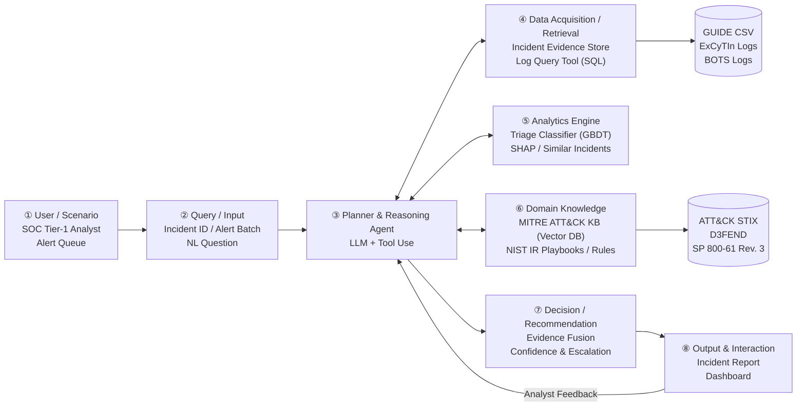
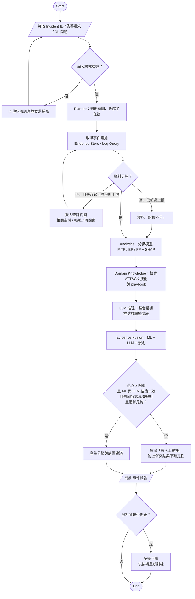

# Design：AI SOC Analyst Agent

> 由 `DESIGN.md` v0.8 轉換而來。動機見 `proposal.md`；行為契約見 `specs/`；核心思維 M1–M5 與取捨 T1–T3 見 `docs/project-core.md`。

## Context

- **目前狀態**：Proposal 階段。Agent 本體尚未實作；已完成 GUIDE 資料檢查（`experiments/e0_profile_guide.py`）。
- **GUIDE 實測**：Train 2.4 GB、9,516,837 列、707,108 起事件、5,769 個組織；事件標籤 BP 49.0%、FP 30.4%、TP 20.6%。
- **關鍵限制**：
  - `AlertTitle` 與所有實體欄位（IP、帳號、裝置等）都是匿名化數字 ID，LLM 讀不出語意；`Category`、`MitreTechniques`、`EntityType` 為可讀文字。
  - `MitreTechniques` 只在 42.5% 的列有值；處置標籤 99.4% 缺值，無法用 GUIDE 量化評估處置建議。
  - 時間戳記依論文說明已加入雜訊。
- **資源限制**：開發期 6 週；LLM 實驗花費上限約 550 美元；分級模型只需 CPU。

## Goals / Non-Goals

**Goals:**
- 以 8 個模組（① User → ⑧ Output）實作 specs 定義的行為，模組職責清楚、可分別替換與做消融。
- 讓每個升級決策都能以可檢查的規則重現，而不是依賴 LLM 的自我判斷。

**Non-Goals:**
- 不取代偵測器，也不偵測未產生告警的攻擊（承接 [1][7] 的定位）。
- 不自動執行處置動作（隔離主機、停用帳號）；只提出建議，由分析師執行。
- 不訓練或微調 LLM；只透過 API 使用。
- 不做即時串流處理；以事件為單位批次處理。

## Decisions

### D1. 系統架構：以 Planner 為中心的 8 模組



| 模組 | 規格 | 程式位置（規劃） |
|---|---|---|
| ② Input | `triage-request` | `src/soc_agent/schemas.py` |
| ③ Planner、④ Retrieval | `evidence-gathering` | `agent/planner.py`、`data/evidence_store.py`、`tools/log_query.py` |
| ⑤ Analytics | `triage-classification` | `analytics/triage_model.py`、`explain.py` |
| ⑥ Knowledge | `attack-mapping` | `knowledge/attack_kb.py`、`playbooks/` |
| ⑦ Decision | `triage-decision` | `decision/fusion.py` |
| ⑧ Output | `triage-report` | `report.py`、`app/dashboard.py` |
| 實驗 | `triage-evaluation` | `experiments/e1_triage.py` … `e5_cost.py` |

**替代方案**：單一 LLM 端到端分級。不採用，因為 GUIDE 欄位匿名化，且 [3] 顯示 LLM Agent 單獨分級漏判 ≥ 40.4%。

### D2. 處理流程



### D3. 演算法

```text
Algorithm 1: SOC Triage Agent
Input : Incident request Q (incident ID, alert batch, or NL question)
        Triage model M, ATT&CK knowledge base KB, playbook set PB
        Confidence threshold τ, tool-call budget B
Output: Triage report R

01: req ← ValidateAndParse(Q)
02: if req is invalid then return ErrorReport("missing or malformed input")
03: plan ← Planner.Decompose(req)                 ▷ subtasks: gather, classify, map, recommend
04: E ← ∅ ; calls ← 0
05: repeat                                         ▷ evidence gathering loop
06:     tool ← Planner.SelectTool(plan, E)
07:     E ← E ∪ tool.Execute(req, E)               ▷ every item carries its source reference
08:     calls ← calls + 1
09: until Planner.IsSufficient(E) or calls ≥ B
10: x ← ExtractFeatures(E)
11: p ← M.PredictProba(x)                          ▷ p = (p_TP, p_BP, p_FP)
12: φ ← SHAP(M, x)                                 ▷ top contributing features
13: S ← RetrieveSimilarIncidents(x, k)
14: T ← MapToATTACK(E, KB)                         ▷ techniques, tactics, kill-chain stage
15: K ← KB.Retrieve(T) ∪ PB.Retrieve(T)            ▷ RAG context
16: llm ← LLM.Reason(E, p, φ, S, T, K)             ▷ returns label, rationale, confidence
17: (label, conf, flags) ← FuseEvidence(p, llm, Rules(T))      ▷ Algorithm 2
18: if conf < τ or "conflict" ∈ flags or "high_risk" ∈ flags or not Planner.IsSufficient(E) then
19:     R.status ← "NEEDS_HUMAN_REVIEW"
20: else
21:     R.status ← "AUTO_TRIAGED"
22: R.actions ← PB.Recommend(label, T)
23: R ← R ∪ {label, conf, evidence: E, shap: φ, similar: S, attack: T, rationale: llm.rationale, flags}
24: return R
```

```text
Algorithm 2: FuseEvidence
Input : ML probabilities p, LLM output llm, rule results U
        Weights w_ml, w_llm (w_ml + w_llm = 1)
Output: label, confidence conf, flag set flags

01: flags ← ∅
02: q ← OneHotWithConfidence(llm.label, llm.confidence)
03: s ← w_ml · p + w_llm · q                      ▷ weighted class scores
04: label ← argmax(s) ; conf ← max(s)
05: if argmax(p) ≠ llm.label then flags ← flags ∪ {"conflict"}
06: if U contains a high-risk pattern then        ▷ e.g. late kill-chain stage
07:     flags ← flags ∪ {"high_risk"}
08:     if label ≠ TP and p_TP ≥ τ_safety then label ← TP    ▷ NFR2: prefer escalation
09: return (label, conf, flags)
```

### D4. 分級主力用 GBDT，LLM 負責整合與解釋

- **選擇**：LightGBM / XGBoost 預測三類機率，SHAP 解釋。
- **理由**：GUIDE 是大量結構化、匿名化資料；GBDT 便宜、穩定、機率可校準、SHAP 工具成熟。LLM 的價值放在整合 ATT&CK 知識、處理衝突、產生報告，以及在 ExCyTIn 上撰寫 SQL 調查。
- **替代方案**：深度模型（訓練成本高、解釋性差）、純 LLM（見 D1）。

### D5. `IsSufficient(E)` 以規則判斷

- **選擇**：三項規則全部成立才算足夠（見 `evidence-gathering` 規格）。在 GUIDE 上沒有原始 log，第 3 項改為檢查每筆告警的證據列是否齊全，並把代表「無此實體」的固定 ID 視為缺值。
- **理由**：[3] 發現 LLM 在查無紀錄時最容易過早結案；[25] 發現需要升級的告警，分析師會蒐集更多種類的資訊。
- **替代方案**：讓 LLM 自評是否足夠。不採用。

### D6. LLM 信心只取三級

- **選擇**：`OneHotWithConfidence` 把「低／中／高」對應到 c = 0.5、0.7、0.9；判斷類別得到 c，其餘兩類平分 1 − c。例如 TP、信心「中」→ q = (0.7, 0.15, 0.15)。
- **理由**：LLM 自報的連續數值信心通常不可靠；三級較穩定，數值在驗證集上調整。

### D7. Planner 的決策點

| 決策點 | 依據 | 不同的路徑 |
|---|---|---|
| 選擇資料來源 | 輸入型態 | Incident ID → Evidence Store（GUIDE）；自然語言問題 → Log Query Tool（ExCyTIn，自行產生並執行 SQL） |
| 擴大查詢的方向 | `IsSufficient(E)` 哪一項未滿足 | 缺帳號上下文 → 查登入紀錄；缺主機上下文 → 查程序與網路紀錄；查詢為空 → 先確認 log 是否中斷 |
| 擴大查詢的範圍 | 已對應到的攻擊鏈階段 | 出現 Lateral Movement 時把相關主機納入下一輪 |
| 何時停止 | `IsSufficient(E)` 或用完預算 B | 足夠就分析；用完預算仍不足就標記並升級 |

### D8. 技術選型

| 模組 | 技術 | 理由 |
|---|---|---|
| 資料處理 | Python、pandas、DuckDB | DuckDB 可直接以 SQL 查詢大型 CSV，筆電即可處理 |
| 分級模型 | LightGBM / XGBoost、SHAP | 見 D4 |
| 知識庫 | ATT&CK STIX 2.1、mitreattack-python、Chroma | 官方格式、現成套件、輕量向量資料庫 |
| Agent | LLM API（tool use） | 原生支援工具呼叫 |
| 介面 | Streamlit | 少量程式碼即可做出 Demo |

## Risks / Trade-offs

- [GUIDE 欄位匿名化，LLM 讀不出語意] → 分級以 ML 為主；原始 log 推理改用 ExCyTIn 評估。
- [GUIDE 只涵蓋兩週、單一廠商生態系，泛化有限] → 依組織與時間切分評估；以 ExCyTIn / BOTS 做跨資料集展示；在 Limitations 說明。
- [類別不平衡，TP 召回偏低] → class weight；以 TP 漏判率為首要指標。
- [LLM 幻覺：錯誤的 ATT&CK 對應或建議] → RAG 並要求引用來源；與 ML 交叉檢查；衝突時升級。
- [LLM 成本與延遲] → 工具呼叫上限 B 與 token 預算；先用 200 個事件開發；必要時只對 ML 不確定的事件呼叫 LLM。
- [升級率過高造成告警疲勞（T1）] → 以漏判率–升級率曲線選 τ，而不是只追求漏判率為 0。
- [ExCyTIn 環境建置困難] → 第 5 週仍無法運作就改用 Splunk BOTS v3。
- [時程只有 6 週] → 實驗依 E1 → E2 → E5 → E3 → E4 的優先順序執行。

## Open Questions

- 實體欄位中代表「無此實體」的固定 ID（例如 `IpAddress` 的 360606）是否在所有實體欄位都存在？（不影響規格，只影響前處理細節）
- 同一事件內各列標籤是否一致？若不一致，以最後一列或多數決為準，在前處理時決定。
- R5 的戰術數門檻（目前 4）在驗證集上確認。
